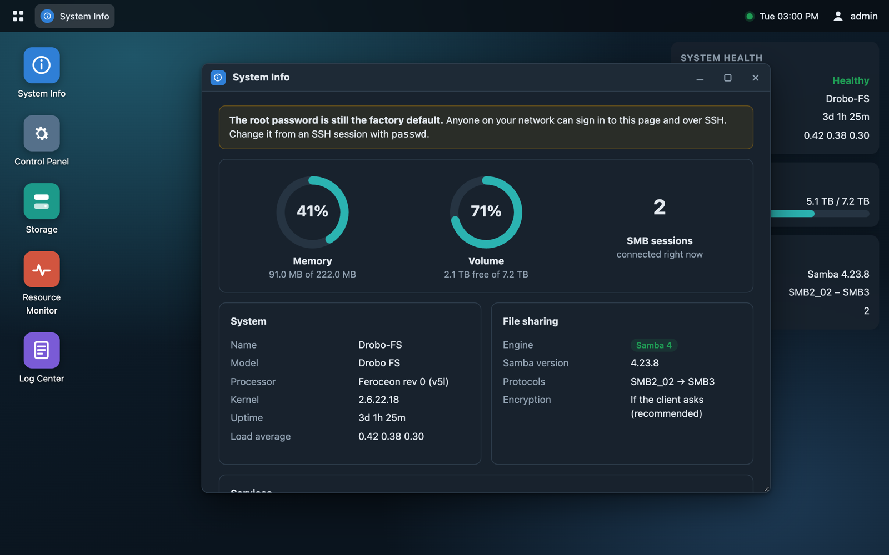
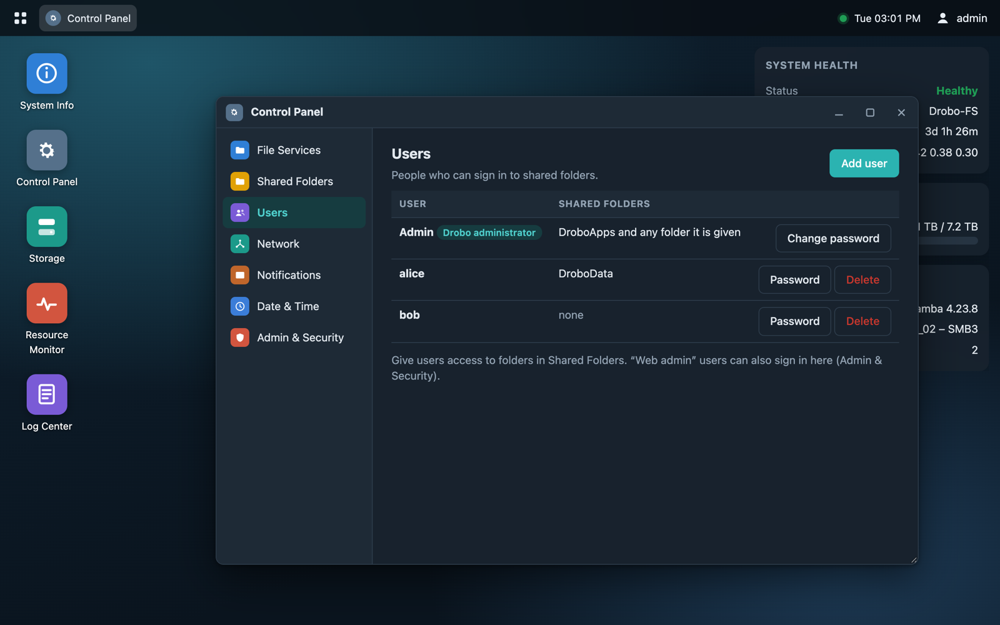
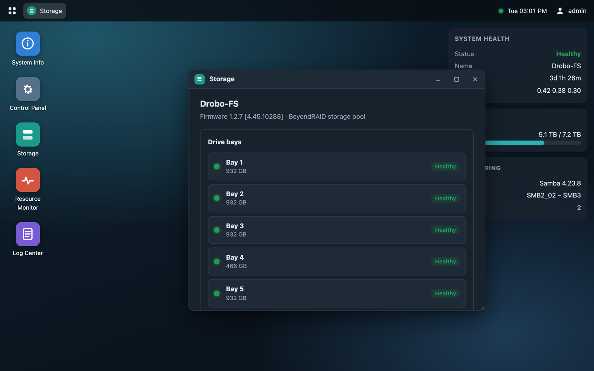
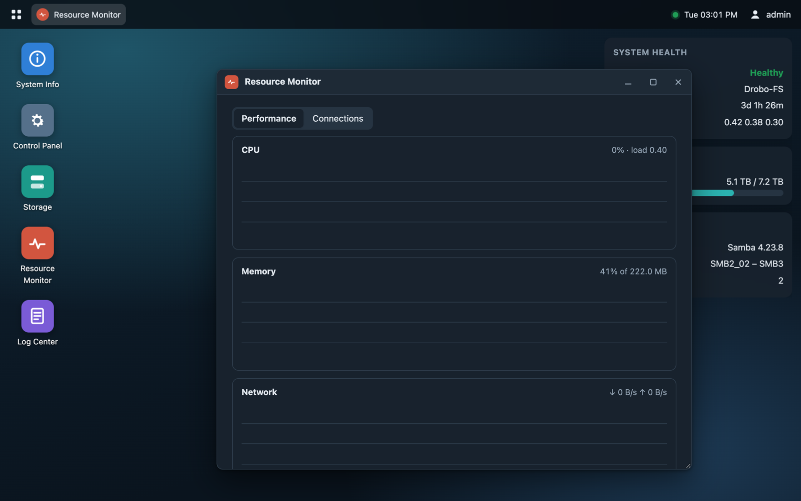

# Encore for the Drobo FS

**A second act for a discontinued NAS.** Encore is a DroboApp that brings a Drobo FS
up to date with modern file sharing (SMB 3), a browser-based admin console, and a clock
that stays right. It runs alongside the stock firmware and never writes to the Drobo's
flash.

Drobo stopped making and supporting its products. The Drobo FS still works as storage,
but its final firmware (1.2.7) only speaks SMB 1. Current macOS and Windows versions
discourage SMB 1 or turn it off, and Drobo Dashboard is no longer maintained. Encore
replaces the parts that aged badly and leaves BeyondRAID and your data alone.

## Features

**Modern file sharing**
- Samba 4.23 replaces the built-in Samba 3.4: SMB 2, SMB 3.0 and SMB 3.1.1, with signing
  and AES encryption, globally or per share.
- Time Machine over SMB, with an optional size limit per share.
- Recycle bins and hidden shares.
- Bonjour advertising, so the Drobo appears in the Finder sidebar.
- Mac metadata (Finder tags, resource forks) is stored even though the Drobo's ext3 has no
  extended attributes.

**A web admin, at `https://<your-drobo>:8443/`**
- **System Info**: memory, volume usage, Samba version, connected sessions and the
  state of every service, including other DroboApps such as OpenSSH, Pure-FTPd and Apache.
- **Control Panel**:
  - *File Services*: SMB versions, encryption, signing and NetBIOS.
  - *Shared Folders*: create, rename and delete shares; per-user read/write or read-only
    access; Time Machine; recycle bin.
  - *Users*: add and delete users, change passwords.
  - *Network*: name, workgroup, DHCP or static address, jumbo frames.
  - *Notifications*: email alerts.
  - *Date & Time*: time zone, NTP servers, sync now.
  - *Admin & Security*: who may sign in, Drobo admin password, HTTPS certificate.
- **Storage**: protected capacity and the status of each drive bay.
- **Resource Monitor**: live CPU, memory, network and disk activity, plus SMB sessions.
- **Log Center**: Encore, Samba, Drobo NAS daemon, web server and kernel logs.

Users, shares, network and email settings are changed through the Drobo's own management
service, `nasd`, exactly as Drobo Dashboard does it. Dashboard keeps working, and changes
made in either place show up in the other.

| Control Panel | Storage | Resource Monitor |
|---|---|---|
|  |  |  |

**A clock that stays right**
The Drobo FS's real-time clock doesn't hold time, and the firmware tries NTP only once at
boot. Encore retries until the network is up, re-syncs every hour, and logs any
correction of a second or more.

**Nothing is permanent**
Encore never touches the firmware in flash. It takes over Samba with bind mounts that
disappear on reboot or when the app stops. One click in the web admin switches back to
stock Samba, and deleting the app folder removes Encore completely.

## Requirements

- A **Drobo FS** on firmware **1.2.7** (the final release). Other Drobo models (5N, 5N2,
  B810n) use different hardware and firmware and are not supported.
- DroboApps enabled in Drobo Dashboard (this creates the `DroboApps` share).
- About 60 MB free on the Drobo.

## Install in 3 steps

1. Download **[encore.tgz](https://github.com/grman68/drobofs-encore/releases/latest/download/encore.tgz)**
   from the [latest release](https://github.com/grman68/drobofs-encore/releases/latest).
   Keep the file name exactly `encore.tgz`.
2. Copy it into the Drobo's **DroboApps** share.
3. Restart the Drobo from Drobo Dashboard. A few minutes after it comes back, open
   `https://<your-drobo>:8443/` and sign in with your Drobo admin name and password.

The **[installation guide](docs/INSTALL.md)** has every step in detail. It also covers
upgrading, going back to stock Samba, uninstalling, and troubleshooting.

## Documentation

| Document | What's in it |
|---|---|
| [Installation guide](docs/INSTALL.md) | Install, first sign-in, upgrade, undo, uninstall, troubleshooting |
| [How it works](docs/ARCHITECTURE.md) | Firmware anatomy, the Samba takeover, nasd integration, the clock, file layout |
| [Building from source](docs/BUILDING.md) | Buildroot toolchain, patches for the 2.6.22 kernel, tests, making a release |
| [nasd protocol](docs/nasd-protocol.md) | The Dashboard ↔ Drobo management protocol, recovered from firmware 1.2.7 |
| [Third-party software](THIRD_PARTY.md) | Bundled open-source components, their licenses, and where to get the source |

## Known limits

- **Speed:** about 25 MB/s read and write over SMB 3.1.1 from a Mac, unencrypted. The
  Drobo FS's ARMv5 CPU is the bottleneck. Encryption runs in software and is slower.
- **User and share changes take about 25 seconds.** `nasd` rebuilds every account and
  restarts Samba and AFP for each change, as it does for Dashboard.
- **Drive health (SMART)** lives on the Drobo's closed VxWorks side, so Drobo Dashboard is
  still the place to see it. Bay status and capacity show in Encore.
- **Stays on the Drobo's 2007-era kernel (2.6.22).** Drobo never released the source of
  the driver between Linux and BeyondRAID, so the kernel can't be upgraded. Encore is built
  to run on it.
- **SMB 1 is off by default.** Very old clients (Windows XP, early Linux media players)
  need the minimum protocol lowered in *File Services*.

## License

Encore's own code (scripts, Lua backend, web UI and build files) is released under the
[GNU General Public License v3.0](LICENSE). The release download also contains Samba,
rsync, uClibc-ng, OpenSSL, lighttpd, Lua and other components under their own licenses.
See [THIRD_PARTY.md](THIRD_PARTY.md), which also explains where to get their source.

Encore is an independent project. It is not affiliated with or endorsed by Drobo, Inc. or
StorCentric. "Drobo", "BeyondRAID" and "DroboApps" are trademarks of their owners. Use it
at your own risk, and keep backups of anything that matters, as with any storage
change.
